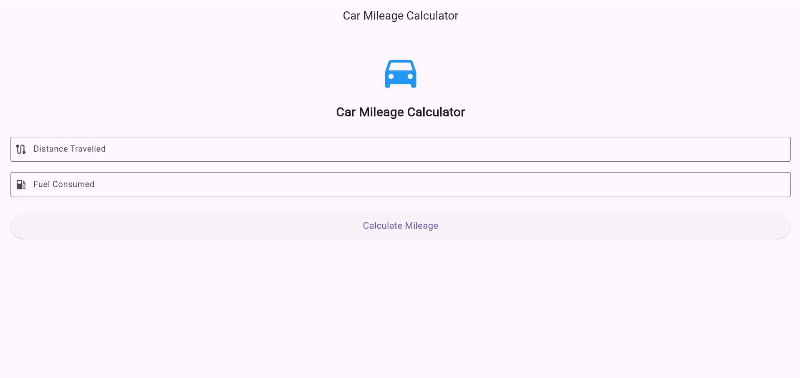
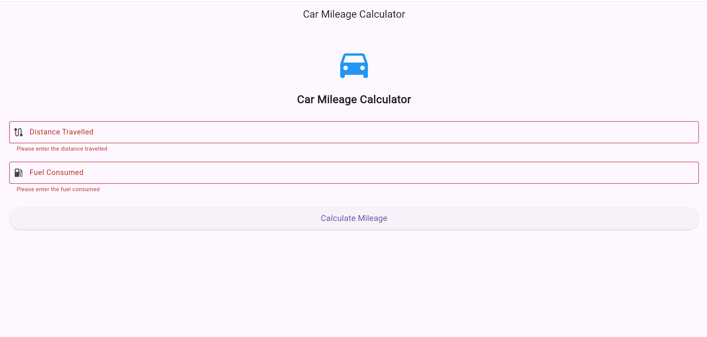
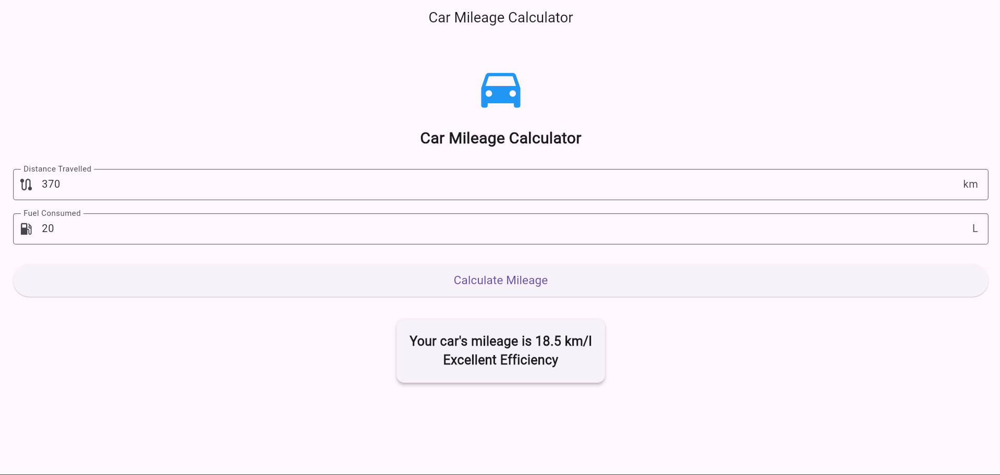
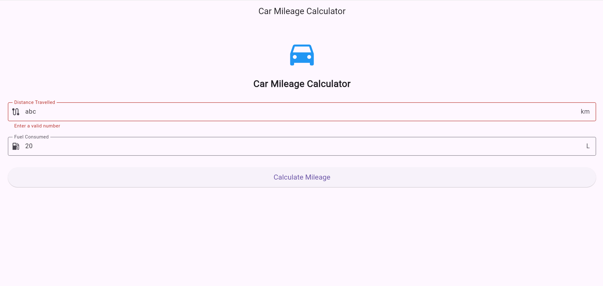

# Experiment 4 – Form Validation using Stateful Widgets

## Aim

To design and implement a Car Mileage Calculator using Flutter Forms, TextFormField, Input Widgets, and Stateful Widgets. The application validates user inputs and displays the calculated mileage dynamically.

## Description

This experiment demonstrates the development of a Car Mileage Calculator using Flutter and Dart.

The application accepts the distance travelled and fuel consumed as user inputs. Form validation is used to ensure that the entered values are valid. The mileage is calculated using the formula:

**Mileage = Distance Travelled / Fuel Consumed**

The application uses:

- **StatefulWidget** to manage changing application state
- **Form** to group and validate input fields
- **TextFormField** to accept user input
- **TextEditingController** to read input values
- **Validator** to check user inputs
- **ElevatedButton** to calculate mileage
- **setState()** to dynamically update the result
- **Card** to display the calculated mileage

The application also classifies the mileage into:

- **Poor Efficiency** – Less than 10 km/l
- **Average Efficiency** – 10 to 15 km/l
- **Excellent Efficiency** – More than 15 km/l

## Technologies Used

- Flutter
- Dart
- StatefulWidget
- Form
- TextFormField
- TextEditingController
- Input Validation
- setState()
- Material Design

## Output Screenshots

### Initial Screen

### Validation Screen

### Calculated Mileage

### Invalid Values

## Result

A Car Mileage Calculator was successfully designed and implemented using Flutter and Dart. The application uses Stateful Widgets, Forms, TextFormField, input validation, and setState() to calculate and display the mileage dynamically.
